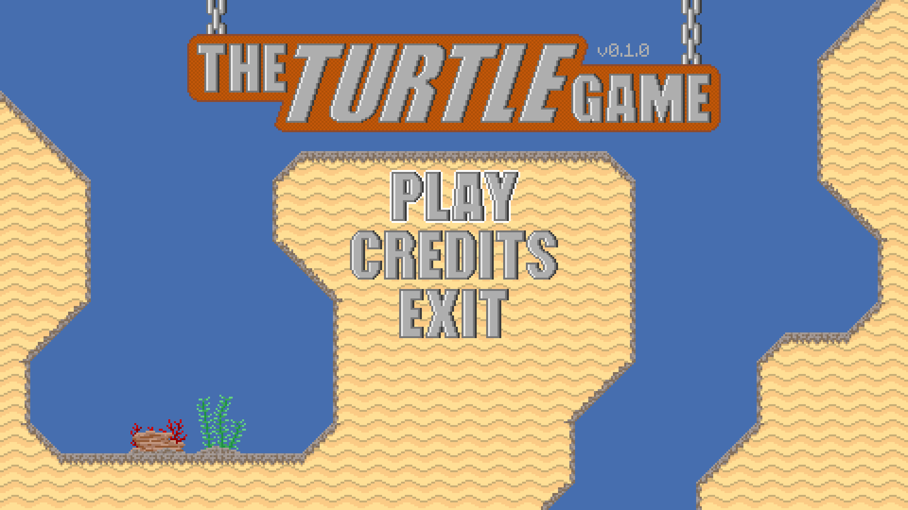
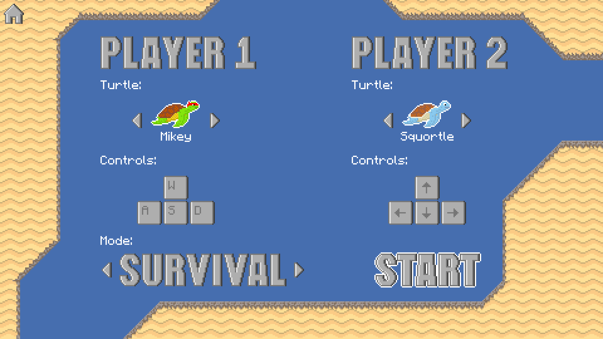
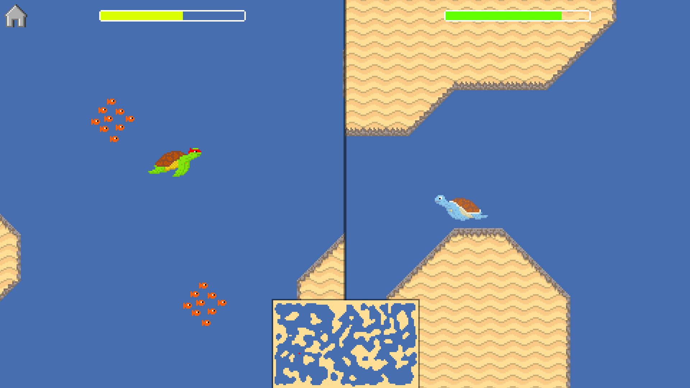
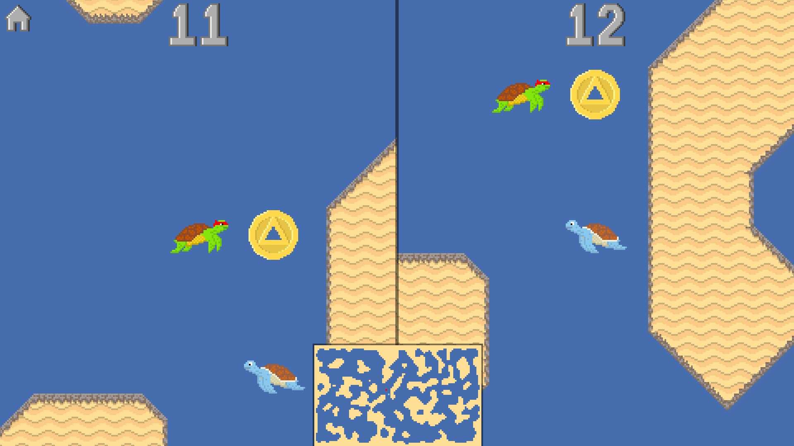

# The Turtle Game
The Turtle Game is a competitive two-player (shared keyboard) game written in C++ using SFML.









## Building and Running

### Prerequisites
- CMake (3.10 or higher)
- C++ compiler with C++11 support
- SFML2 library

### macOS Setup
1. Install SFML2 via Homebrew:
   ```bash
   brew install sfml@2
   ```

### Building
1. Clone the repository:
   ```bash
   git clone <repository-url>
   cd the-turtle-game
   ```

2. Create a build directory and configure:
   ```bash
   cd build/resources
   cd .. && make && cd ./resources && ../TheTurtleGame
   ```

### Running
1. Run the game from the build directory:
   ```bash
   cd build/resources
   ../TheTurtleGame
   ```

The game will start with a splash screen and then show the main menu. Use the keyboard to navigate and play!
